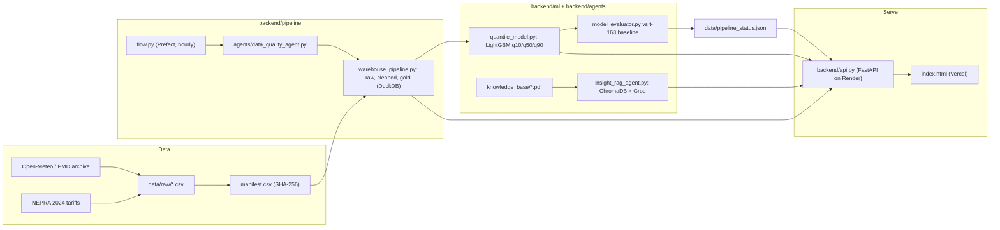

# Bijli-Insight Pakistan · بجلی بصیرت پاکستان

**National energy intelligence for Pakistan's grid.** Bijli-Insight forecasts hourly temperature (the main driver of cooling demand) for Karachi, Lahore and Islamabad with honest uncertainty bands. It turns those forecasts into practical guidance: when the heat peaks, when to avoid heavy load, what a NEPRA bill will cost, and what NEECA/NEPRA policy actually says.

HackInsight 2026 · Energy Demand track

| | |
|---|---|
| **Live dashboard** | https://bijli-insight-pakistan.vercel.app |
| **Live API** | https://bijli-insight-api.onrender.com ([health](https://bijli-insight-api.onrender.com/health), [status](https://bijli-insight-api.onrender.com/api/status)) |

> The API runs on Render's free tier and sleeps when idle. The first request after a pause can take about 50 seconds; after that, responses are fast.

---

## Results

Every figure below is read from `data/pipeline_status.json`, written by the pipeline's last run. The dashboard reads the same file through `/api/status`; nothing is typed into the UI.

| Metric | Value |
|---|---|
| Model MAE, median forecast (q50) | **0.4023 °C** |
| Declared baseline MAE (same hour last week, t − 168) | **1.8795 °C** |
| Error reduction vs baseline | **78.6%** |
| Records in warehouse | 52,632 hourly rows (3 cities, 2024–2025) |
| Train / test split | Chronological 80 / 20 (41,702 / 10,426 rows), no shuffling |
| Unit tests | 18 / 18 passing |

The baseline was declared before training (see [`Dataset_Declaration.md`](Dataset_Declaration.md)).

---

## What it does

1. **Verified data.** Hourly Open-Meteo / PMD archives for three cities, plus NEPRA 2024 tariff slabs. Every raw file is fingerprinted with SHA-256 in `data/raw/manifest.csv`, and the warehouse build re-hashes the files and refuses to run if a single byte has changed.
2. **3-layer DuckDB warehouse.** Raw (manifest-verified) → `cleaned_weather` → `gold_weather_features`, with lag features (t−1, t−24, t−168) and a 24-hour rolling mean, computed without future leakage.
3. **Data Quality Agent.** Runs on every incoming record: **FIX** wrong types/units, **FILL** short gaps (marked `is_imputed`), **FLAG** physically implausible values (`is_anomalous`, never silently dropped). Decisions go to `data/quality_log.json`.
4. **Quantile forecasting.** Three LightGBM models trained with pinball loss give q10 / q50 / q90, so every forecast is a range, not a single guess. Non-crossing (q10 ≤ q50 ≤ q90) is enforced after prediction.
5. **Hourly pipeline.** A Prefect flow (`5 * * * *`) fetches the latest observation, audits it, appends it to the warehouse and re-runs inference, updating `pipeline_status.json` and `prefect_runs.csv`.
6. **Grounded policy advisor (RAG).** NEECA policy PDFs are indexed in ChromaDB. A Groq-hosted LLM writes answers only from the retrieved passages, and citations (document and page) come from retrieval metadata, not from the model. If the documents don't cover a question, it answers "I don't know".
7. **Dashboard.** A single static page (`index.html`) designed in the language of a Pakistani electricity bill, with five sections:
   - Overview: tomorrow's high, plan-your-day guidance, city comparison, accuracy, source integrity
   - 7-day forecast with the uncertainty band and a 3D hourly heat map
   - NEPRA bill estimator with an appliance builder
   - Policy advisor
   - Data explorer over the warehouse

---

## Architecture



### API

| Endpoint | Returns |
|---|---|
| `GET /api/forecast?city=karachi` | 168 hourly q10 / q50 / q90 values, from Open-Meteo forecast inputs and warehouse lag history |
| `GET /api/weather?city=…&table=…&limit=…` | Warehouse rows plus average/max temperature and humidity |
| `GET /api/status` | Last pipeline run: MAE, baseline MAE, improvement, freshness, record count |
| `GET /api/manifest` | Source files with publisher, licence, row count and SHA-256 |
| `GET /api/tariffs` | NEPRA slab rates from `data/raw/nepra_tariff_slabs_2024.csv` |
| `POST /api/chat` `{question}` | Grounded answer (Markdown), primary source, fallback flag |
| `GET /health` | Liveness check |

---

## Repository layout

```
├── index.html                 Dashboard (static, deployed to Vercel)
├── backend/
│   ├── api.py                 FastAPI service (deployed to Render)
│   ├── pipeline/              data_fetcher, generate_manifest, warehouse_pipeline, flow (Prefect)
│   ├── agents/                data_quality_agent, insight_rag_agent (RAG)
│   └── ml/                    quantile_model (LightGBM), model_evaluator
├── frontend/app.py            Streamlit version of the dashboard (Hugging Face Space)
├── data/
│   ├── raw/                   Source CSVs + manifest.csv (SHA-256 ledger)
│   ├── warehouse.duckdb       Built warehouse
│   ├── chroma_db/             Vector index of the policy PDFs
│   ├── pipeline_status.json   Metrics from the last pipeline run
│   ├── prefect_runs.csv       Pipeline run history
│   └── quality_log.json       Data Quality Agent audit log
├── models/                    Trained LightGBM quantile models (q10, q50, q90)
├── knowledge_base/            NEECA policy PDFs indexed for RAG
├── tests/                     pytest suite (fetcher, warehouse, DQA, model, RAG)
├── docs/                      Architecture walkthroughs, product brief, design system
├── render.yaml                Render blueprint for the API
├── vercel.json                Static deploy config for the dashboard
├── AI_Use_Log.md              AI assistance declaration (submission requirement)
└── Dataset_Declaration.md     Data sources, licences, baseline declaration
```

---

## Run it locally

Tested on Python 3.12 (Render) and 3.13 (local).

```bash
python -m venv .venv
.venv\Scripts\activate          # Windows; use `source .venv/bin/activate` on macOS/Linux
pip install -r requirements.txt pytest prefect

# Optional: enables LLM answers in the policy advisor (otherwise it falls back to "I don't know")
echo GROQ_API_KEY=your_key > .env

pytest tests/ -v                               # 18 tests
python -m backend.pipeline.warehouse_pipeline  # rebuild the DuckDB warehouse from raw CSVs
python -m backend.pipeline.flow                # one pipeline cycle (trains models if models/ is empty)
uvicorn backend.api:app --port 8000            # start the API
```

Then open `index.html` in a browser. When it's served from `localhost` or opened as a file, it calls `http://localhost:8000`; anywhere else it calls the Render API.

Streamlit version: `streamlit run frontend/app.py`.

The Makefile wraps the same commands: `make test`, `make data`, `make pipeline`, `make app`.

---

## Deployment

- **API:** Render web service defined in `render.yaml`. It installs `requirements-render.txt` (backend dependencies without Streamlit), runs `uvicorn backend.api:app`, and is health-checked on `/health`. Set `GROQ_API_KEY` in the Render dashboard.
- **Dashboard:** Vercel static deploy of `index.html` (`vercel.json`, no build step).
- **Streamlit:** Hugging Face Space using the front-matter at the top of this file.

---

## Honest limitations

- Temperature is used as a **proxy** for cooling demand; the system does not forecast MW load directly.
- The bill estimator applies NEPRA 2024 slab rates and approximates taxes and surcharges at 17%. Fixed charges vary by DISCO.
- The policy advisor only knows the indexed NEECA documents. Questions outside them (for example a specific thermostat setting) return "I don't know" rather than a guess.
- The free-tier API sleeps when idle (about 50 s cold start).

---

## Documentation

- [`docs/current_flow.md`](docs/current_flow.md): architecture overview
- [`docs/project_flow.md`](docs/project_flow.md): file-by-file walkthrough of the pipeline
- [`docs/PRODUCT.md`](docs/PRODUCT.md): product brief (users, purpose, principles)
- [`docs/DESIGN.md`](docs/DESIGN.md): dashboard design system
- [`Dataset_Declaration.md`](Dataset_Declaration.md): sources, licences, declared baseline
- [`AI_Use_Log.md`](AI_Use_Log.md): how AI tools were used and what the team verified
